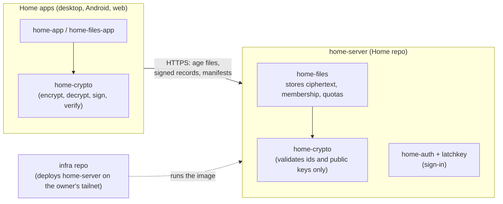

# home-crypto

**Status: unreviewed — do not use for real data before an external review.**

The end-to-end encryption format of Home Files, the family file storage of
[Home](https://github.com/somethim-home/home), a self-hosted home server written in Rust. This crate decides
which [age](https://c2sp.org/age) file is encrypted to which recipients and signed by whom, so that the server
stores and serves files without ever being able to read them. It is a library only: no I/O, no networking, no
storage.

## Overview

### Where it sits



| Repository | Role | Relation to this crate |
| --- | --- | --- |
| [home-crypto](https://github.com/somethim-home/home-crypto) (this one) | The encryption format and its reference implementation | — |
| [home](https://github.com/somethim-home/home) | The server (`home-server`, `home-files`) and the apps | Path dependency (`../home-crypto`). Clients encrypt and decrypt with it; the server uses it only to validate ids and published keys and never holds a key. |
| [latchkey](https://github.com/somethim/latchkey) ([crates.io](https://crates.io/crates/latchkey)) | Sign-in building blocks (passwords, TOTP, passkeys, sessions) | Independent. Signing in to Home does **not** unlock files: unlocking needs the person's passphrase or recovery key. |
| [infra](https://github.com/somethim-home/infra) | Ansible, compose stacks and the release flow of the owner's server | Deploys the Home image that contains this crate. Nothing in infra touches keys. |

### How it works, in short

- Every person has an **identity**: an X25519 grant identity (its recipient is public, so others can invite
  them), an X25519 keyring identity (secret) and an Ed25519 signing key. The identity is stored on the server
  only as two age files: one sealed with the person's passphrase (scrypt), one sealed to a printed recovery key.
- A **space** (a private space, or a shared one such as "Family") has one X25519 identity per **epoch**.
  Objects and the manifest of the space are encrypted to the current epoch's recipient, which the server never
  sees.
- Joining a space is a **grant**: the space identity encrypted to the new member's grant recipient and signed
  by an admin. Membership is a signed **roster**; removing someone is a signed **rotation** to a new epoch,
  after which objects are re-encrypted.
- A person's **keyring** (all their spaces, epochs and pinned verifying keys of other people) is one age file
  encrypted to their keyring recipient, with a version counter that detects rollback.
- The **manifest** (names, folders, sizes, times, hashes) is encrypted too, in segments that merge
  deterministically, so the server sees opaque object ids and sizes, not names.

The exact format is [docs/format.md](docs/format.md); what it protects against, and what it does not, is
[docs/threat-model.md](docs/threat-model.md). All documents are listed in [docs/README.md](docs/README.md).

### Security model in short

- Protected against the server operator, a stolen disk or backup, and network attackers: file contents and
  names, and forged invitations or membership changes from people whose keys you have pinned.
- Not protected: metadata (object ids, sizes, times, membership, access patterns), first contact (trust on first
  use of the key the server publishes), a malicious member or admin, a malicious web bundle, quantum attacks.
- Built only on age (`=0.12.1`) and `ed25519-dalek` (`=3.0.0`); no home-made primitives. The composition is
  our own design and is **pending an external review**; see [SECURITY.md](SECURITY.md) for reporting problems.

### Running it

It is a plain Rust library; no services are needed:

```
cargo test                                     # unit, flow, property and vector tests
cargo check --target wasm32-unknown-unknown    # the web client's target
```

More checks, fuzzing and the test vectors are under [Building and checking](#building-and-checking).
There is no deployment of its own: the [home](https://github.com/somethim-home/home) image compiles it in, and
the [infra](https://github.com/somethim-home/infra) repository deploys that image. It is not published to
crates.io yet (`publish = false`).

### Specific to Home versus reusable

The crate has no knowledge of Home's server, URLs or the owner's setup; the only Home-specific parts are the
names of the record types and the share-link shape (`https://<host>/s/<space-id>#v1:…`). It can be reused by any
application that needs the same model (person identities, spaces with epochs, signed grants and rosters, an
encrypted mergeable manifest), with the caveat above: it is unreviewed.

## Details

End-to-end encryption for Home Files, the family file storage on the home server. One Rust crate shared by every
client (desktop, Android, web via wasm, iOS later via uniffi) and by the `home-files` backend, which uses it for
format validation only and never holds a key.

Encryption is built on the [age](https://c2sp.org/age) format through the official `age` crate (pinned
`=0.12.1`): X25519 recipients, scrypt passphrase recipients and the STREAM payload. Grants, rosters, rotation
records and guardian records are additionally signed with Ed25519 through `ed25519-dalek` (pinned `=3.0.0`), because age cannot
authenticate a sender. There are no other primitives. The design decides *which* age file is encrypted to
*which* recipients and signed by *whom*, and that layer is what needs the review.

- `docs/threat-model.md`: assets, actors, what is protected, the metadata the server still sees, the web-client
  caveat, and what happens when keys are lost.
- `docs/format.md`: the exact format (version 3). Our own design decisions are marked **[own design]** and
  unresolved points **[open]**.

## What it is

- Person identities: create, seal with a passphrase (scrypt) and with a printed recovery key, unlock either way,
  change the passphrase, replace the recovery key. Each person has an Ed25519 signing key; its verifying key is
  published next to the grant recipient, and a person fingerprint (safety number) covers both.
- Keyring: the person's accepted spaces, every epoch key of each, and pinned verifying keys of other people
  (trust on first use). It has a version counter that detects rollback.
- Spaces: per-epoch identities, signed grants (invitations), signed rosters, and signed rotation records for
  removing a member. Members accept membership changes only when an admin of the roster they trust signed them.
- File objects: streaming encryption and decryption with SHA-256 of the content, seekable range reads, a check
  that the object id matches, and re-encryption to a new epoch.
- Manifest: a canonical binary encoding plus encrypted segments, with deterministic merge (commutative,
  associative, idempotent), conflict detection and compaction.
- Share links: the space key travels in the URL fragment.
- Guardian access for kids (module `guardian`, format §9): a kid's identity is wrapped to the kid's passphrase
  key, the kid's recovery key and every guardian (the owner always, plus the parents the owner adds), in a
  signed, hash-chained wrap. A guardian unlocks the kid with their own key and reads everything the kid can.
  Only the owner adds a guardian (the kid's key only re-wraps); removing one rotates the kid's identity, moves every space to the new keys and
  re-keys the spaces the removed guardian could read only through the kid; the kid ends guardian access with a
  new identity only they know and a signed end record.

## What it is not

- Not a server, client or sync engine. Transport, storage, quotas and authentication (home-auth) live elsewhere.
- Not private from guardians. While guardian access lasts, a kid's guardians read everything the kid reads and
  can act as the kid; a removed guardian keeps what they had (see the threat model, "Kids and guardians").
- Not authenticated per file. Grants, rosters and rotations are signed, but objects and manifest entries are
  not: members of a space trust each other with its files. An admin can sign bad membership changes, and a
  first-contact invitation is only as good as the key the server publishes (see the threat model).
- Not metadata-private. Object ids, sizes, times, membership and access patterns are visible to the server.
- Not post-quantum. It uses X25519 only.
- Not protected against a malicious web bundle. A browser client trusts the server that delivers its code.

## Building and checking

```
cargo fmt --check
cargo clippy --all-targets -- -D warnings
cargo test
cargo check --target wasm32-unknown-unknown
```

Test vectors live in `tests/vectors/`; their README explains which are deterministic and how to regenerate them.
Property tests in `tests/manifest_props.rs` cover merge, compaction, encoding and parser robustness;
`tests/signature_props.rs` and `tests/guardian_props.rs` cover the signed records and random sequences of guardian
changes. Guardian flows are in `tests/guardian.rs`. cargo-fuzz targets for the manifest parser and the guardian
record parsers are in `fuzz/`. Running them needs nightly and `cargo install cargo-fuzz`:

```
cd fuzz && cargo +nightly fuzz run manifest_decode seeds/manifest_decode
cd fuzz && cargo +nightly fuzz run guardian_decode seeds/guardian_decode
```

On stable, `cd fuzz && cargo build` builds both targets (without coverage instrumentation).

## Safety notes

- `#![forbid(unsafe_code)]`. The library code has no `unwrap`, `expect`, `panic!`, `unreachable!` or slice
  indexing; clippy denies these outside tests.
- Panic paths that remain in dependencies:
  - age draws its randomness from `rand::rngs::OsRng`, which panics if the OS random number generator fails.
    This affects key generation and every encryption. This crate's own ids use `getrandom` and return an error
    instead.
  - `age::scrypt::Recipient::set_work_factor` asserts `0 < log_n < 64`. `ScryptCost` only allows 1–30, so the
    assertion cannot fire.
  - age's STREAM writer and reader assert internal invariants on chunk sizes.
  - `ed25519-dalek` signing calls an internal `unwrap` on a hashing closure that always returns `Ok`. This crate
    signs with `try_sign` (the `Signer::sign` convenience method would `expect`) and draws signing-key seeds
    from `getrandom`, so it does not use `rand_core`'s `OsRng`.
- `ed25519-dalek` 3 depends on `curve25519-dalek` 5 while age's `x25519-dalek` still uses 4, so both versions are
  compiled in.
- The scrypt identity refuses work factors above `ScryptCost::UNLOCK_MAX` (22), so a hostile identity file cannot
  make unlocking run for hours.

## Findings about the `age` crate (0.12.1)

- **Header re-wrapping is not possible through the public API.** `Encryptor` always generates a fresh file key,
  and `Decryptor` never exposes the header or the file key. Re-wrapping would mean reimplementing age header
  parsing, serialisation and the header MAC on top of `age-core`. Removing a member therefore re-encrypts each
  object instead (format §6.3). This is an open question.
- The scrypt stanza must be the only stanza in a file, so the passphrase and recovery seals are two separate
  files.
- Seekable decryption works: `StreamReader` implements `Seek` when the input is `Read + Seek`.
- There is no way to inject randomness, so ciphertext test vectors cannot be reproduced exactly.
- There is no hybrid post-quantum identity (Go age 1.3 has `age1pq…`; the Rust crate only has the
  encrypt-only `tag`/`tagpq` recipients).
- It builds for `wasm32-unknown-unknown` once `getrandom`'s `js` feature is enabled, which `Cargo.toml` does
  for that target. Without age's `web-sys` feature, scrypt calibration falls back to a fixed guess. This crate
  always sets the work factor explicitly, so that does not matter here.

## Licence

Licensed under either of [Apache License, Version 2.0](LICENSE-APACHE) or [MIT license](LICENSE-MIT) at your
option.

Unless you explicitly state otherwise, any contribution intentionally submitted for inclusion in this crate by you,
as defined in the Apache-2.0 license, shall be dual licensed as above, without any additional terms or conditions.
